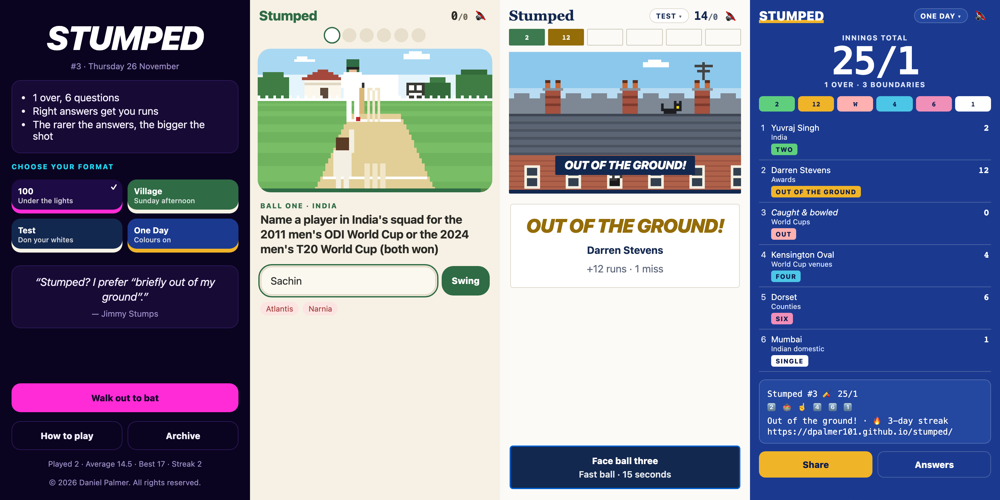

# Stumped 🏏

> [!NOTE]
> This project is 100% vibe coded: built entirely by prompting an AI coding assistant. It is not
> intended as a demonstration of quality engineering. The AI agents make a best effort to test it
> and keep it stable across devices, but a bug-free experience cannot be guaranteed.

A daily cricket knowledge game. One over: six balls, twenty seconds each — the rarer your answer, the bigger the shot.

**Play it: [dpalmer101.github.io/stumped](https://dpalmer101.github.io/stumped/)**



Pick a format, face each ball, and name a right answer before the 20-second timer runs out. Rare
answers go for six or out of the ground; run out of time and you're out.

See [docs/REQUIREMENTS.md](docs/REQUIREMENTS.md) for how it plays, [docs/CRITERIA.md](docs/CRITERIA.md) for the
acceptance criteria and [docs/CONTENT.md](docs/CONTENT.md) for how questions are written and checked.

## Privacy

The live site sends anonymous counts to [GoatCounter](https://www.goatcounter.com/): visits, overs
started and overs finished. There are no cookies, no personal data, and no answers or scores; it's a
plain request with no third-party script. Nothing is counted on local copies, in tests, or when the
browser asks not to be tracked. The site code is set in `src/analytics.ts`.

## Running locally

```bash
npm install
npm run dev
```

`npm run dev` and `npm run build` first generate the day files (`public/days/`) from the question
pool and schedule; rerun `npm run days` after changing either while the dev server is running.

Works on macOS, Windows and Linux with Node 24 (see `.nvmrc`).

The dev server (and `npm run preview`) listens on your local network too. Vite prints a
"Network" address such as `http://192.168.x.x:5173/stumped/`; open it on a phone on the same wifi.
Your computer's local IP is also shown in its network settings (or run `ipconfig` on Windows,
`ipconfig getifaddr en0` on macOS, `hostname -I` on Linux).
If it doesn't load, your computer's firewall is probably blocking it: allow incoming connections for
Node (macOS: System Settings → Network → Firewall; Windows: allow Node.js on private networks when
prompted, or in Windows Defender Firewall; Linux: open the port, e.g. `sudo ufw allow 5173`).

For a stable copy that never reloads by itself (e.g. on a phone while content is being edited), serve
a build instead: `npm run build && npm run preview`, then open `http://<your-computer-ip>:4173/stumped/`.

### Trying share on a phone

Browsers only allow the share sheet and clipboard on secure (https) pages, so over plain http the
Share button falls back to copying. To try the real share sheet locally, serve over https:

```bash
npm run build && npm run preview:https
```

Open `https://<your-computer-ip>:4443/stumped/` on the phone and accept the certificate warning (it's a
self-signed certificate for local testing). GitHub Pages is https, so the live site needs nothing extra.
